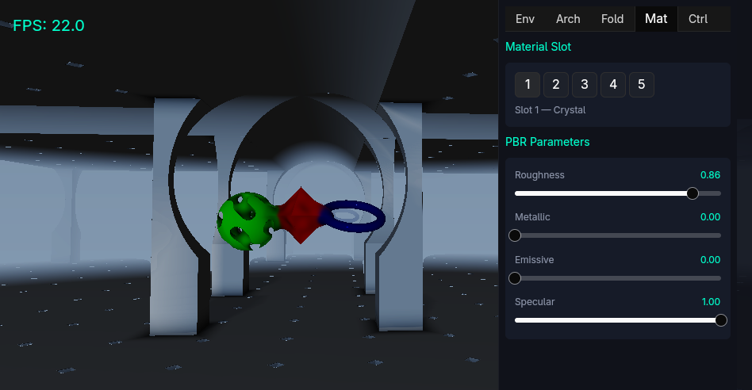

# Raymarching Renderer in CubeCL 0.11.0 with wgpui GUI


## Live Demo (Web-Wasm WebGPU)

The web build ([https://sensn.github.io/sdf_demo/](https://sensn.github.io/sdf_demo/)) uses **CubeCL** compute shaders via **WebGPU**, so your browser must have WebGPU hardware acceleration enabled.

### Linux

#### Chrome / Chromium (Recommended)
On Linux, WebGPU requires Vulkan support. If you are running a **Wayland** desktop session, Chromium's native Wayland Ozone backend is currently incompatible with Vulkan swapchains, so launch it using the X11 (XWayland) backend:

* **Wayland session:**
  ```bash
  chromium --ozone-platform=x11 --enable-unsafe-webgpu --enable-features=Vulkan https://sensn.github.io/sdf_demo/
  ```
  *(Replace `chromium` with `google-chrome` or `brave` if applicable.)*

* **X11 session:**
  ```bash
  chromium --enable-unsafe-webgpu --enable-features=Vulkan https://sensn.github.io/sdf_demo/
  ```

To verify WebGPU is active, open `chrome://gpu` and confirm **WebGPU** shows **Hardware accelerated**.

#### Firefox
Firefox's WebGPU compute support on Linux is still experimental and disabled by default:
1. Open `about:config` in the address bar and accept the risk warning.
2. Search for `dom.webgpu.enabled` and set it to **`true`**.
3. *(Optional, if adapter creation fails)* Set `gfx.webgpu.force-enabled` to **`true`**.
4. Restart Firefox and open `https://sensn.github.io/sdf_demo/`.

---

### Windows

* **Chrome / Edge / Brave (Recommended):**
  WebGPU is enabled out of the box (backed by DirectX 12). Simply open `https://sensn.github.io/sdf_demo/`.
  * *(If you have multiple GPUs or WebGPU is disabled by driver blocklists, enable `chrome://flags/#enable-unsafe-webgpu` and restart the browser.)*
* **Firefox:**
  Enabled by default on recent Windows releases, or via `about:config` → `dom.webgpu.enabled = true`.

---

### macOS

* **Chrome / Edge / Brave (Recommended):**
  WebGPU is enabled out of the box (backed by Metal) on macOS 13+ (Apple Silicon & Intel). Open `https://sensn.github.io/sdf_demo/`.
* **Safari (macOS Sonoma 14 / Sequoia 15+):**
  * **Safari 18+:** WebGPU is enabled by default.
  * **Safari 17:** Enable **Develop** menu (*Safari → Settings → Advanced → Show features for web developers*), then enable **Develop → Feature Flags → WebGPU**.
* **Firefox:**
  WebGPU on macOS is still experimental; enable via `about:config` → `dom.webgpu.enabled = true` and restart.

## Build & run

```
cargo build --release --bin sdf_demo_iced
target/release/sdf_demo_iced
```

or

```
cargo run --release --bin sdf_demo_iced
```